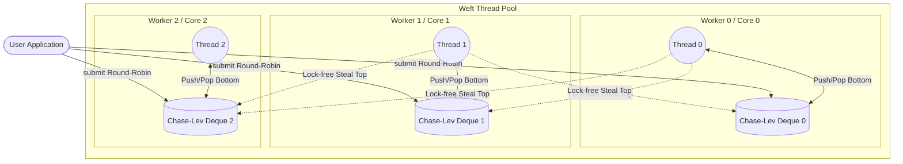

# Weft 🧵

> A high-performance, lock-free, work-stealing thread pool and scheduler written in C++20.

Weft implements an ultra-low latency thread pool designed around the **Chase-Lev work-stealing deque**. It heavily focuses on mechanical sympathy, hardware-awareness, and zero-contention observability.

## Features

- **Lock-Free Work Stealing:** Employs a strictly lock-free Chase-Lev deque utilizing `std::atomic` and explicit memory ordering (`acquire`, `release`, `seq_cst`).
- **Hardware-Aware:**
  - Eliminates **false sharing** by aggressively aligning thread-local structures to cache line boundaries (`alignas(64)`).
  - Pins worker threads directly to physical CPU cores via OS-level affinity (`pthread_setaffinity_np`) to maximize L1/L2 cache locality.
- **Zero-Contention Metrics:** Features a background TUI (Text User Interface) dashboard that aggregates metrics using relaxed atomics, introducing absolutely zero observer-effect latency on the hot path.

## Architecture

Weft operates by distributing tasks across thread-local deques. When a thread exhausts its own queue, it aggressively steals work from the top of another thread's deque, drastically reducing lock contention and maximizing throughput.



## Getting Started

### Prerequisites
- A C++20 compliant compiler (GCC 10+, Clang 10+).
- CMake 3.14+

### Building

```bash
mkdir build && cd build
cmake ..
make
```

### Running the Dashboard Simulation

Weft includes a built-in simulation that visually demonstrates the work-stealing and queue drainage in a rich ANSI terminal interface.

```bash
./weft_cli
```

## Usage

```cpp
#include "weft/thread_pool.h"
#include <iostream>
#include <atomic>

int main() {
    // Initialize pool with hardware threads (e.g., 4)
    weft::ThreadPool pool(4);
    
    std::atomic<int> counter{0};
    
    // Submit tasks lock-free
    for (int i = 0; i < 1000; ++i) {
        pool.submit([&counter]() {
            counter.fetch_add(1, std::memory_order_relaxed);
        });
    }
    
    return 0;
}
```

## License
MIT License
